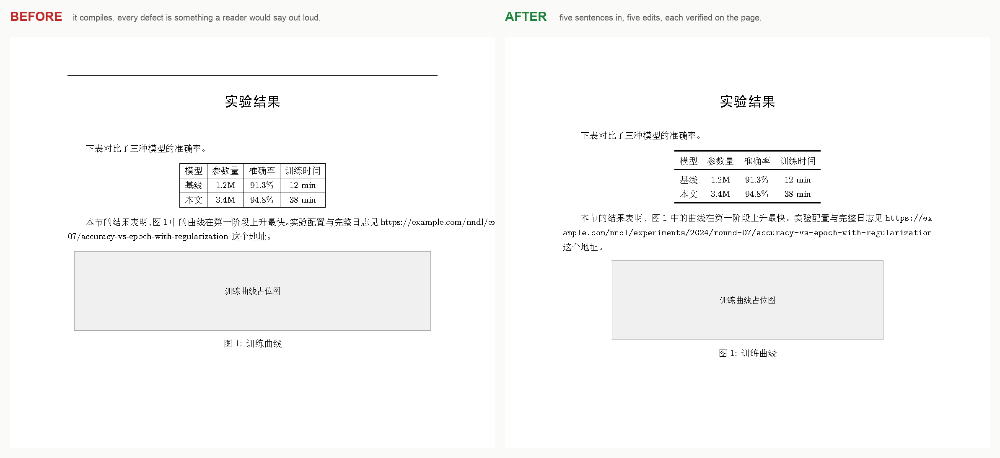

# latex-look — 让 Agent 真正「看见」你的 LaTeX

[](https://www.npmjs.com/package/dsh-latex-look)
[](LICENSE)
[English](README.md) · **简体中文**



*左边编译**零错误**：标题上下各一条横线、表格是带竖线的网格、长链接冲出版心、
图顶到了页边。右边是五句人话之后的同一页。可直接复现：[`examples/broken-layout`](examples/broken-layout)。*

---

## 它解决什么问题

一个只会读 `.tex` 源码的 Agent 是**瞎的**。

文档可以编译零错误、打开正常，但读者一眼就看出不对：这页最上面多了一条横线、这个表格丑、
这段文字压到了页边、图太大了、两页之间空了一大块、图号怎么从 3-4 跳回 3-3 了……
这些**没有一条是编译错误**，`grep` 也搜不到——那条横线根本不在源码里，它是宏包画的。

这类需求你只能这样表达：

> 「把这一页最上面的横线去掉」「这个表格改成三线表」「图小一点」
> 「这两页之间空太多了，填满」「图号顺序不对」

`latex_look` 就是让 Agent 接得住这些话：**编译 → 渲染成图 → 定位到源码行 → 改完再比一次**，
一个调用做完。Agent 于是能进入 `看 → 诊断 → 改 → 再看 → 确认` 的循环，而不是改完就说「应该好了」。

## 三个能力，一个动词

| 你说的话 | 它做什么 |
|---|---|
| 「这页最上方的横线去掉」 | 渲染该页，把那条线**定位到源码行**（`fancyhdr` 的 `\headrulewidth`，或某个 `\rule`） |
| 「表格改成三线表」 | 改完渲染，用**像素 diff** 告诉你只动了表格、没碰正文 |
| 「图号顺序不对」 | 扫全书**阅读顺序**，直接列出 `图 3-4 (p63) → 图 3-3 (p64)` |
| 「这次改动有没有弄坏别处」 | 全书 `audit`：只报**这一次**新造成的版面问题，并点名是哪个图把页面顶走的 |

```bash
latex-look main.tex --page 62                    # 渲染第 62 页
latex-look main.tex --page 62 --at "图 3-1"       # 定位到源码行
latex-look main.tex --page 62 --compare           # 与上一版并排对比
latex-look main.tex --page 1  --sequence 图       # 检查图号阅读顺序
latex-look main.tex --page 1  --audit             # 全书版面回归审计
```

## 这不是「AI 帮你写 LaTeX」

写 LaTeX 的工具已经很多了（生成、补全、编译服务）。这个工具管的是**验收**：
改完之后，那份 PDF 到底对不对。

这也是为什么它值得单独存在——**编译器只保证「不是错误」，不保证「好看」**。

## 真实战绩

用一本 215 页的中文技术书（6 章、163 张图、129 个公式、术语表、目录）当靶子，
读者只能看 PDF、逐像素量、拒绝「我觉得没问题」：

- 编译错误 **0**，Overfull hbox **0**
- 163 个图题全部按阅读顺序，**0 处倒序**
- 129 个公式编号分章连续 `(1-1)` … `(6-1)`
- 9 处「页面下方空一大块」全部压到 ≤56 mm
- 六章首页首行墨迹**全部 17.0%** 页高——没有任何一章被图占了章名位置

完整记录（含每个缺陷的成因与修法）：[CASE-STUDY.md](CASE-STUDY.md)。

## 安装

需要 Node ≥ 18、TeX 引擎（`xelatex`/`lualatex`/`pdflatex`/`latexmk` 或 tectonic）、
`synctex`、`ghostscript`。

DeepSeek Harness 插件形态：

```
plugin_manager  action: install_bundle  target: dsh-latex-look
```

命令行形态：

```bash
npm i -g dsh-latex-look
```

Agent 的「眼睛」由工具提供；[`SKILL.md`](SKILL.md) 提供「看到症状之后怎么改」的知识——
一份**症状 → 成因 → 修法**的手册，例如「读者说的那条横线通常是 `\pagestyle`/`fancyhdr`，
不是某个 `\hline`」。

## 更新

插件每天在后台查一次 npm，有新版本时在**一次**工具回复里加一行提示；离线时完全静默。

```bash
latex-look --version
latex-look --check-update
```

## 许可

MIT。
